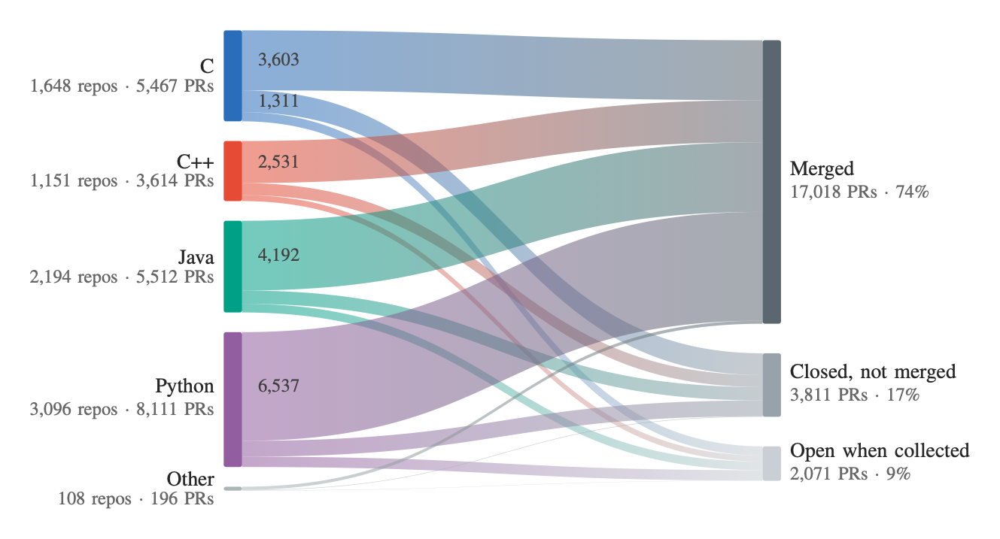

# CREST: Code Review Extraction of Security Topics

The dataset is available on Zenodo at
[https://doi.org/10.5281/zenodo.23670655](https://doi.org/10.5281/zenodo.23670655).

CREST is a dataset of security-related code review discussions mined from
GitHub pull requests (PRs) in C, C++, Java, and Python repositories. For each
PR it includes the description, reviews, inline review comments, discussion
thread, timeline, commits, and diffs. Each PR is also linked to the CVEs it
mentions (with their NVD entries) and to weaknesses in MITRE's Common Weakness
Enumeration (CWE).

The release contains two datasets:

- **CREST**: 22,900 PRs from 8,197 repositories. Each one mentions a CVE or
  CWE, changes source code, and links to at least one valid CWE.
- **CREST-LLM**: the 16,026 of those PRs that an LLM (GPT-6 Luna) classified
  as containing a security discussion.

This repository also contains the scripts used to build the dataset, so you
can reproduce or extend it.

## At a Glance

<p align="center">
  
</p>

<p align="center"><em>Flow of CREST's PRs from the repository's language to the
PR's outcome when we collected it. Flow width is proportional to the number of
PRs. Other: repositories for which GitHub reports a different language or none,
mostly forks.</em></p>

CREST covers PRs created on or before August 12, 2026. Before filtering, the
search found 492,568 PRs from 263,282 repositories that had at least two
participants. The 22,900 PRs in CREST reference 18,420 distinct CVEs and cover
412 distinct CWEs.

## Data Layout

Each PR is stored in its own directory, `data/<owner>/<repo>/<pr_id>/`:

```yaml
data/<owner>/<repo>/:
  <pr_id>/<pr_id>.json:            PR metadata (title, description, author, state,
                                   timestamps, merge status, ...)
         <pr_id>.diff:             Unified diff of the PR
         cves.json:                CVE IDs mentioned in the PR
         cwes.json:                CWE IDs linked to the PR, directly or via its CVEs
         comments.json:            PR review comments
         timeline.json:            PR issue timeline
         reviews/<review_id>.json: Review objects
                 comments.json:    All review comments
         commits/<sha>.json:       Commit metadata
                 <sha>.diff:       Commit diff
```

Names in angle brackets are placeholders: `<owner>/<repo>` is the GitHub
repository (e.g. `torvalds/linux`), `<pr_id>` is the PR number,
`<review_id>` is GitHub's ID for a review, and `<sha>` is a commit's Git hash
(its 40-character ID, e.g. `3f786850e387550fdab836ed7e6dc881de23001b`).

The PR, review, and commit JSON files come from the GitHub REST API. `cwes.json`
records where each CWE came from:

```json
{
  "CWE-20":  {"mentioned": true,  "via_cves": ["CVE-2021-44228"]},
  "CWE-79":  {"mentioned": true,  "via_cves": []}
}
```

Supporting data:

```yaml
cves/<cve_id>/<cve_id>.json:  NVD entry for each CVE mentioned in a PR
              history.json:   NVD change history for that CVE
cwes/weakness/cwe-<id>.json:  MITRE CWE catalog: weaknesses,
     category/cwe-<id>.json:                     categories,
     view/cwe-<id>.json:                         and views
sample-judgments-human.csv:   Final manual label for each sampled PR
                              (SecurityRelated / NotSecurityRelated)
llm-filtering/prompt-template.md: The prompt used to classify PRs with the LLM
```

<!-- TODO: list the archive file names on Zenodo (e.g. one archive per
     dataset) once the upload layout is decided. -->

## How the Dataset Was Built

1. **Mine PRs** (`pr-miner.py`). Search GitHub for PRs that mention `CVE-`
   or `CWE-` in repositories written in C, C++, Java, or Python, leaving out
   PRs opened by Dependabot. Keep PRs with at least two participants, at least
   one of them human. Then download each PR's metadata, diff, reviews,
   comments, timeline, and commits.
2. **Link CVEs** (`find-cves-in-prs.py`, `cve-downloader.py`). Extract the
   CVE IDs mentioned in each PR, leaving out its diff, and download their
   NVD entries.
3. **Link CWEs** (`cwe-miner.py`, `find-cwes-in-prs.py`). Download MITRE's
   CWE catalog. Link each PR to the CWEs it mentions and to the CWEs in its
   CVEs' NVD entries, keeping only IDs that exist in the catalog.
4. **Filter** (`move-dependabot.py`, `filter-prs.py`). Remove Dependabot PRs,
   PRs with no diff or only test changes, PRs that change no source file, and
   PRs with no valid CWE. What remains is **CREST**.
5. **Label a sample by hand** (`generate-sample.py`). Draw a reproducible
   systematic sample of 370 PRs. Two raters label each one, and the raters
   resolve their disagreements through discussion.
6. **Classify with an LLM** (`llm-filtering/`). Classify every PR with the
   prompt in `llm-filtering/prompt-template.md` (`run.py`), and evaluate the
   labels against the manual sample (`evaluate_sample.py`). The PRs labeled
   security-related form **CREST-LLM** (`build-dataset.py`).
7. **Report statistics** (`top-cwes.py`, `make-repo-figure.py`). Produce the
   CWE rankings and the language-to-outcome figure.

## Reproducing the Dataset

Install the requirements:

```sh
python3 -m venv
source .venv/bin/activate
pip install -r requirements.txt
```

Copy `.env.example` to `.env` and fill in:

- `GH_TOKEN_LIST`: GitHub personal access tokens, for mining PRs
- `NVD_API_KEY` (optional): raises the NVD rate limit when downloading CVEs
- `OPENAI_API_KEY` or `GEMINI_API_KEY`: only for the LLM classification step

Then run the tools below in the order shown above. Note that GitHub data
changes over time, so a new run will not match the released dataset exactly.

# Tools

To aid reproducibility, there are make targets:

```sh
python3 -m venv
source .venv/bin/activate
make mine-prs cwes cves filter
```

To regenerate a sample, run `make gen-sample`.

To regenerate the data/figure in the paper, run `make top-cwes figure`.

## GitHub Pull Request Miner

Downloads GitHub PR data (JSON, diffs, reviews, comments) with automatic
token rotation when rate limits are hit.

Usage:
```sh
    python pr-miner.py [options] <repo1> [<repo2> ...]
```

Environment:
```
    GH_TOKEN_LIST  Comma-delimited list of GitHub personal access tokens.
                   Set this in a .env file (see .env.example).
```

Data is stored under `data/<owner>/<repo>/<pr_id>/`. See
[Data Layout](#data-layout) for every file in that folder. Without any flag,
only `<pr_id>.json` (the PR metadata) is written. Each other file needs a flag:

| Flag         | Writes                                              |
|--------------|-----------------------------------------------------|
| `--diffs`    | `<pr_id>.diff`                                      |
| `--reviews`  | `reviews/<review_id>.json`, `reviews/comments.json` |
| `--comments` | `comments.json`                                     |
| `--timeline` | `timeline.json`                                     |
| `--commits`  | `commits/<sha>.json`, `commits/<sha>.diff`          |

`cves.json` and `cwes.json` are added later by `find-cves-in-prs.py` and
`find-cwes-in-prs.py`.

### Usage

```
usage: pr-miner.py [-h] [--languages LANG [LANG ...]] [--min-participants N] [--keywords KW [KW ...]] [--opened-before ISO_DATE] [--no-language-filter]
                [--reviews] [--comments] [--timeline] [--commits] [--data-dir DIR] [--verbose]
                [owner/repo ...]

positional arguments:
  owner/repo            Repositories to scrape (e.g. torvalds/linux). Not required when --reviews, --comments, --timeline, or --commits is used alone
                        to backfill existing data.

options:
  -h, --help            show this help message and exit
  --data-dir DIR        Root directory for downloaded data (default: data).
  --verbose, -v         Enable debug logging.

filtering:
  --languages LANG [LANG ...]
                        Only include repos written in these languages (default: ['Java', 'Python', 'C', 'C++']). Pass an empty string to disable
                        language filtering.
  --min-participants N  Minimum number of unique participants (default: 2).
  --keywords KW [KW ...]
                        Keywords to search for in PR title/body (default: ['CWE-', 'CVE-']).
  --opened-before ISO_DATE
                        Only include PRs opened before this date (default: 2026-08-12T00:00:00+00:00).
  --no-language-filter  Disable language filtering entirely.

modes:
  --diffs               Download (or backfill) PR diffs.
  --reviews             Download (or backfill) PR reviews.
  --comments            Download (or backfill) PR review comments.
  --timeline            Backfill PR issue timeline data (stored as timeline.json).
  --commits             Backfill PR commit metadata and diffs (stored in commits/).
```

## CWE Catalog Miner

Downloads the full Common Weakness Enumeration (CWE) catalog from MITRE's
public REST API (`cwe-api.mitre.org`) — no XML parsing, no credentials
required.

Usage:
```sh
    python cwe-miner.py [options]
```

Data is stored under `cwes/<type>/cwe-<id>.json` (or `--data-dir`):
```
    weakness/cwe-<id>.json   One file per CWE weakness entry
    category/cwe-<id>.json   One file per CWE category entry
    view/cwe-<id>.json       One file per CWE view entry
```

### Usage

```
usage: cwe-miner.py [-h] [--start START] [--end END]
                    [--types {category,view,weakness} [{category,view,weakness} ...]]
                    [--data-dir DATA_DIR] [--force] [--verbose]

options:
  -h, --help            show this help message and exit
  --start START         Only write entries with CWE ID >= START.
  --end END             Only write entries with CWE ID <= END.
  --types {category,view,weakness} [{category,view,weakness} ...]
                        Which CWE entry types to download (default: all).
  --data-dir DATA_DIR   Root directory for downloaded data (default: cwes).
  --force               Re-fetch from the API and overwrite existing files.
  --verbose, -v         Enable debug logging.
```

Reruns are safe: existing `cwe-<id>.json` files are skipped unless
`--force` is passed.

## CVE Downloader

Downloads a single CVE's metadata and change history from NVD's public
REST API (`services.nvd.nist.gov`), given its ID.

Usage:
```sh
    python cve-downloader.py CVE-2021-44228 [options]
```

Environment:
```
    NVD_API_KEY  Optional. Raises the rate limit from 5 req/30s to 50
                 req/30s. Set this in a .env file (see .env.example).
```

Data is stored under `cves/<id>/` (or `--data-dir`), as the full,
unmodified NVD API response for each endpoint:
```
    <id>.json      Raw response from the CVE metadata endpoint
    history.json   Raw response from the CVE history endpoint
                   (cveChanges merged across pages if there was more than one)
```

### Usage

```
usage: cve-downloader.py [-h] [--data-dir DATA_DIR] [--force] [--skip-history]
                         [--verbose]
                         cve_id

positional arguments:
  cve_id               CVE ID to download, e.g. CVE-2021-44228

options:
  -h, --help           show this help message and exit
  --data-dir DATA_DIR  Root directory for downloaded data (default: cves).
  --force              Re-fetch from the API and overwrite existing files.
  --skip-history       Only fetch metadata, skip the (slow) history scan.
  --verbose, -v        Enable debug logging.
```

Reruns are safe: existing files are skipped unless `--force` is passed.

## Find CVEs in PRs

Scans every mined PR under `data/` for CVE ID mentions, then invokes
`cve-downloader.py` for each distinct CVE found so its metadata gets
downloaded. Every file in a PR's directory is scanned as plain text
(not schema-aware JSON parsing) except `*.diff` files, which are excluded
since they include unchanged surrounding context lines that can produce
false matches unrelated to that PR.

Requires `cve-downloader.py` to be present alongside this script.

Usage:
```sh
    python find-cves-in-prs.py [options]
```

### Usage

```
usage: find-cves-in-prs.py [-h] [--data-dir DATA_DIR]
                           [--cve-data-dir CVE_DATA_DIR] [--force]
                           [--skip-history] [--verbose]

options:
  -h, --help            show this help message and exit
  --data-dir DATA_DIR   Root directory of mined PR data (default: data).
  --cve-data-dir CVE_DATA_DIR
                        Root directory passed to cve-downloader.py for
                        downloaded CVE data (default: cves).
  --force               Pass --force through to cve-downloader.py to
                        re-fetch and overwrite existing files.
  --skip-history        Pass --skip-history through to cve-downloader.py.
  --verbose, -v         Enable debug logging.
```

## Filtering PRs

We moved any PRs from Dependabot using `move-dependabot.py` and then filter
any PRs that don't change a source file using `filter-prs.py`.

## Find CWEs in PRs

For every mined PR under `data/`, collects CWE IDs from two sources and
writes them to a per-PR `cwes.json`:

1. **Direct mentions** in the PR's own JSON files (scanned as plain text,
   recursively, including `reviews/` and `commits/`). `*.diff` files are
   excluded, as are the output files `cves.json` and `cwes.json`.
2. **Via CVEs**: CWE IDs mentioned in the downloaded NVD metadata
   (`cves/<id>/<id>.json`) of every CVE listed in the PR's `cves.json`.
   NVD placeholders like `NVD-CWE-noinfo` aren't real CWE IDs and don't
   match.

CWE IDs are normalized (e.g. `CWE-01` → `CWE-1`, `cwe-79` → `CWE-79`), and
only CWEs that exist are kept: a CWE is valid if its metadata file is present
under `cwes/weakness/`, `cwes/category/` or `cwes/view/`. Invalid CWEs are
dropped (logged with `--verbose`).

Requires, in order:
- `cwe-miner.py` to have downloaded the CWE catalog into `cwes/`
- `find-cves-in-prs.py` to have written each PR's `cves.json` (and
  downloaded the CVE metadata into `cves/`)

Usage:
```sh
    python find-cwes-in-prs.py [options]
```

Output, `data/<owner>/<repo>/<pr_id>/cwes.json`, is keyed by CWE ID and
records where each one came from:
```json
{
  "CWE-20":  {"mentioned": true,  "via_cves": ["CVE-2021-44228"]},
  "CWE-400": {"mentioned": false, "via_cves": ["CVE-2021-44228"]},
  "CWE-79":  {"mentioned": true,  "via_cves": []}
}
```
`mentioned` is true if the CWE appears in the PR's own files (source 1);
`via_cves` lists the CVEs whose metadata mentions it (source 2).

### Usage

```
usage: find-cwes-in-prs.py [-h] [--data-dir DATA_DIR]
                           [--cve-data-dir CVE_DATA_DIR]
                           [--cwe-data-dir CWE_DATA_DIR] [--verbose]

options:
  -h, --help            show this help message and exit
  --data-dir DATA_DIR   Root directory of mined PR data (default: data).
  --cve-data-dir CVE_DATA_DIR
                        Root directory of downloaded CVE metadata, see cve-
                        downloader.py (default: cves).
  --cwe-data-dir CWE_DATA_DIR
                        Root directory of downloaded CWE metadata, see cwe-
                        miner.py (default: cwes).
  --verbose, -v         Enable debug logging.
```

Reruns are safe: each PR's `cwes.json` is regenerated from scratch.

## Manual Sample

Draws the sample of PRs that the raters labeled by hand, and writes it to
`sample.xlsx` with each PR assigned to two raters. The sample is systematic
(every k-th PR from a random start), and the fixed seed makes it reproducible.
By default its size is calculated for a 95% confidence level and a 5% margin of
error, and the work is spread evenly over 6 raters.

The final labels, after the raters resolved their disagreements, are in
`sample-judgments-human.csv` (columns `PR` and `Judgment`, with
`SecurityRelated` or `NotSecurityRelated`).

Usage:
```sh
    python generate-sample.py [options]
```

### Usage

```
usage: generate-sample.py [-h] [--sample-size SAMPLE_SIZE] [--raters RATERS]
                          [--seed SEED] [--data-dir DATA_DIR]

options:
  -h, --help            show this help message and exit
  --sample-size SAMPLE_SIZE
                        number of PRs to sample (default: calculated)
  --raters, --num-raters RATERS
                        number of human raters (default: 6)
  --seed SEED           random seed (default: crest-pr-miner)
  --data-dir DATA_DIR   PR data root (default: data)
```

## LLM Classification

The scripts in `llm-filtering/` classify every PR as security-related or not,
evaluate those labels against the manual sample, and build CREST-LLM. The
prompt is in `llm-filtering/prompt-template.md`; it lists what counts as a
security discussion and what does not (for example, dependency bumps or
documentation-only changes).

Run them from inside `llm-filtering/`:

```sh
cd llm-filtering

# 1. Classify every PR (GPT-6 Luna is the cheapest OpenAI model)
python run.py --llm openai --usecheapest --output responses

# 2. Compare the labels with the manual sample and print precision/recall
python evaluate_sample.py

# 3. Build CREST-LLM from the PRs labeled "security"
python build-dataset.py ../crest-llm
```

- `run.py` writes one `<owner>_<repo>_<pr_id>_response.json` file per PR under
  `responses/<llm>/<model>/<owner>/`, and skips PRs that already have one
  (use `--force` to redo them). Use `--sample-only` to classify only the
  sampled PRs, or `--showprompt` to print the prompt without calling the LLM.
  It needs `OPENAI_API_KEY` (or `GEMINI_API_KEY` with `--llm gemini`) in `.env`.
- `build-dataset.py` creates symbolic links to the original PR folders instead
  of copying them. Tools such as `zip -r` follow the links, so the archive
  holds the real files.

### Usage

```
usage: run.py [-h] (--output OUTPUT | --showprompt) [--directory DIRECTORY]
              --llm {openai,gpt5,gpt5full,gemini,geminipro,ollama}
              [--model MODEL] [--usecheapest] [--thinking] [--sleep SLEEP]
              [--timeout TIMEOUT] [--force] [--pr PR] [--sample-only]

usage: evaluate_sample.py [-h] [--judgments JUDGMENTS]
                          [--responses-dir RESPONSES_DIR]

usage: build-dataset.py [-h] [--responses-dir RESPONSES_DIR]
                        [--source-dir SOURCE_DIR]
                        [output]
```

## Most Frequent CWEs

Ranks CWEs by the number of mined PRs that list them. Dependabot PRs and PRs
with no valid CWE aren't counted.

Requires, in order:
- `cwe-miner.py` to have downloaded the CWE catalog into `cwes/`, which provides
  the CWE names
- `find-cwes-in-prs.py` to have written each PR's `cwes.json`

Usage:
```sh
    python top-cwes.py [options]
```

Output goes to the terminal, and no files are written:
- The number of PRs counted and the number of distinct CWEs
- A table of the top CWEs, with each one's PR count, share of PRs, and how many
  PRs mention it directly or link to it through a CVE
- A sentence naming the top CWEs, for use in the paper

Each PR counts once per CWE and can list several, so the shares don't add up to
100%.

### Usage

```
usage: top-cwes.py [-h] [--data-dir DATA_DIR] [--cwe-dir CWE_DIR] [--top TOP]

options:
  -h, --help           show this help message and exit
  --data-dir DATA_DIR  Root directory of mined PR data (default: data).
  --cwe-dir CWE_DIR    Root directory of the CWE catalog (default: cwes).
  --top TOP            How many CWEs to show (default: 5).
```

## Language-to-Outcome Figure

Generates the paper's Sankey figure, showing how PRs flow from their
repository's language to their outcome: merged, closed without merging, or open.
Dependabot PRs and PRs with no valid CWE are left out, so run
`find-cwes-in-prs.py` first.

<!-- language-figure:start -->
<!-- language-figure:end -->

Usage:
```sh
    python make-repo-figure.py [options]
```

This writes the figure to `figures/fig-language-outcome.tex` and prints the
totals. If they're 0, check `--data-dir`. The paper's preamble needs
`\usepackage{tikz}` (or `pgfplots`) and `graphicx`.

Add `--svg` to also create an image and show it above. Commit `README.md` and
`figures/` for it to appear on GitHub.

### Usage

```
usage: make-repo-figure.py [-h] [--data-dir DATA_DIR] [--out OUT]
                           [--svg [PATH]]

options:
  -h, --help           show this help message and exit
  --data-dir DATA_DIR  Root directory of mined PR data (default: data).
  --out OUT            Output .tex file (default: figures/fig-language-
                       outcome.tex in the repo; the folder is created if
                       missing).
  --svg [PATH]         Also write an SVG image and show it in README.md
                       (default path: figures/fig-language-outcome.svg in the
                       repo).
```
